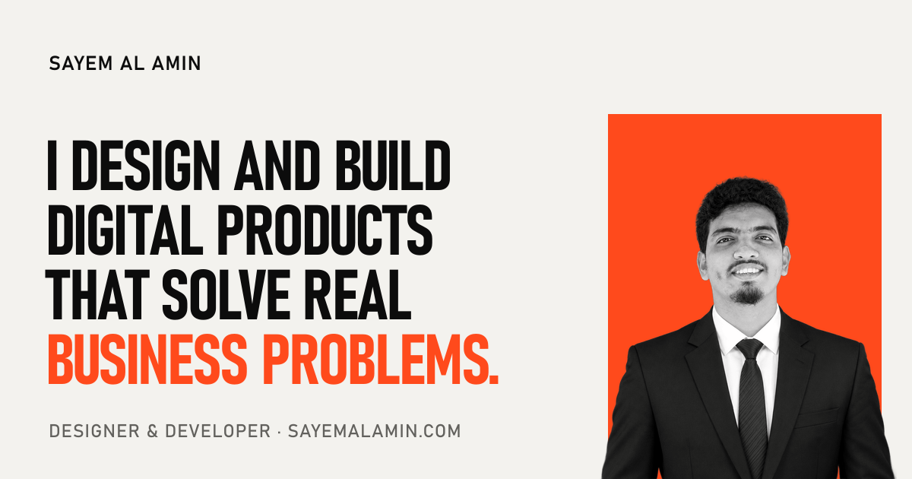

# sayem.me

[](https://sayem.me)

Personal portfolio of **Sayem Al Amin**, designer and developer.
A fast, static, single-page site built with Astro and plain CSS.

**Live:** https://sayem.me

[](https://github.com/alamin2507/portfolio/actions/workflows/ci.yml)
[](LICENSE)
[](https://sayem.me)

## Highlights

- **Static and light.** No backend, no database, no UI framework. One small JavaScript file (about 3 kB).
- **Motion in CSS first.** 3D text-ring loader, scroll-linked reveals, an accordion of service columns and a pinned process section, built mostly with CSS scroll-driven animations. Everything respects `prefers-reduced-motion`.
- **Secure by default.** Strict Content Security Policy with no inline scripts or styles, HSTS, `nosniff`, frame blocking, and a locked-down Permissions-Policy (see [`vercel.json`](vercel.json)).
- **Accessible.** Semantic HTML, one `h1`, visible focus, keyboard-reachable menus and service columns.
- **Self-hosted fonts.** Sofia Sans Condensed and Sofia Sans, served from the same origin.
- **Optimised images.** The portrait is served as AVIF and WebP in several sizes through `astro:assets`.

## Tech stack

| Area | Choice |
|---|---|
| Framework | [Astro](https://astro.build) (static output) |
| Styling | Plain CSS with design tokens (custom properties) |
| JavaScript | One file, `public/main.js` |
| Hosting | Vercel, deployed from `main` |
| CI | GitHub Actions: install, audit, build (actions pinned to commits) |
| Updates | Dependabot pull requests, weekly for npm, monthly for Actions |

## Getting started

Requires Node.js 22.23.4 or newer.

```bash
npm install
npm run dev       # local preview at http://localhost:4321
npm run build     # production build into dist/
npm run preview   # serve the built site
```

## Project structure

```
docs/                 PRD (what is built) and SOP (how changes are made)
public/               Files served as-is: main.js, favicon, share image, robots.txt
src/data/site.ts      All content: text, links, services, projects, skills
src/styles/global.css Design tokens and shared classes
src/layouts/          Page shell: <head>, fonts, meta tags
src/components/       One file per section, each with its own scoped styles
src/pages/            index.astro (section order) and 404.astro
vercel.json           Security and cache headers
```

To change text, links or projects, edit `src/data/site.ts` only.

## How this was built

This site is itself the first case study in the portfolio: planned in writing first (a PRD and an SOP in [`docs/`](docs/)), then built in small, reviewed steps with AI assistance. The working rules for AI agents are in [`AGENTS.md`](AGENTS.md).

## Security

See [SECURITY.md](SECURITY.md) for how to report a vulnerability privately.

## License

The source code is released under the [MIT License](LICENSE).
The photographs, share image and written content are © Sayem Al Amin, all rights reserved.
